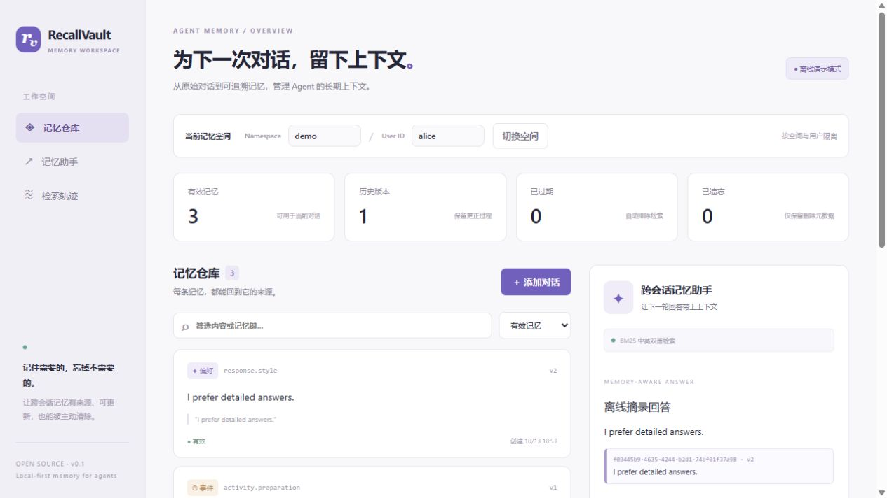

# RecallVault

A standalone local agent-memory workbench with grounded extraction, scoped recall, explicit corrections and erasure-aware execution.

[中文](../README.md)

## Run

Python 3.11 / 3.12. Create a virtual environment, install `pip install -e '.[dev]'`, and run `recallvault serve`. Visit `http://127.0.0.1:8013`. `recallvault demo` seeds `demo/alice` once; `recallvault eval` executes ten deterministic integration fixtures in a temporary database.

No API key is required for demo mode. Demo extraction recognizes only the documented English/Chinese preference, timezone and preparation prefixes; demo answers are extractive BM25 results, not LLM output.

## Design

- User-turn quotes ground typed fact/preference/episode candidates. Writes verify scope, exact source substring, immutable session and stable key.
- SQLite immediate transactions, optimistic revisions and idempotency keys coordinate explicit corrections. Previous revisions are superseded.
- BM25 uses English words and Chinese characters/bigrams. Optional real embeddings use finite-vector validation, exact model identity and dimensions, revision-aware caching, cosine ranking and reciprocal rank fusion. No synthetic semantic vectors are generated.
- TTL excludes expired memories at retrieval and final citation validation. Forget clears all revisions of a key, source sessions, vectors and scoped trace contents. Tombstones remain; seed flags prevent automatic resurrection.
- A bounded Chat Completions tool loop exposes only scoped `recall_memory` and `get_memory`. Final citations must have been actually recalled and must still match current memory text/revision. Unsupported answers must abstain.

## Optional hosted models

Copy `.env.example` to `.env`. Set `RECALLVAULT_MODE=live`, `RECALLVAULT_API_KEY`, and a **Chat Completions function-tool capable** `RECALLVAULT_MODEL`. Model choice is explicit; Responses-only models are not supported by this adapter. Optional `RECALLVAULT_EMBEDDING_MODEL` must exactly match the returned model ID. Configure the expected dimensions. Enabling either feature sends relevant data to that endpoint.

HTTP requests are bounded to 512 KiB responses and 15-second request timeout, one transient retry, a 45-second whole-operation budget and six tool calls. Redirects are disabled. Semantic mode caps scopes at 100 active memories; indexing happens on demand and may require retry after a time-budget error.

## Verification

Run `python -m pytest -q`, `python -m ruff check src tests`, `recallvault eval`, and `python -m build`. GitHub Actions runs Windows/Ubuntu with Python 3.11/3.12. Live provider protocols are tested using HTTP mocks; no hosted-model accuracy, latency or cost benchmark is claimed.

## Limits

Scopes are data boundaries, not authentication. Bind to loopback and run a single process; add real authentication/authorization before any network deployment. Exact quotes prove provenance, not semantic truth. Forget is application-level deletion, not forensic erasure of WAL files, disks, backups or remote provider copies. The operation lock prevents in-flight runs recreating forgotten traces only inside one service process.

See [API contract](api-contract.md), [architecture](architecture.md), [security](../SECURITY.md), and [contribution guide](../CONTRIBUTING.md). MIT licensed.
