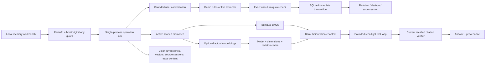

# Architecture and invariants

## Write path

Scope is explicit and never accepted from model tool arguments. A session contains at most 32 turns, each 8,000 characters, with a 32,000-character overall bound. Turns cannot be replaced under an existing session ID. An extracted candidate requires an exact substring from a user turn; assistant turns cannot become sources. Text paraphrases remain proposals and are not semantically entailed by this mechanical check.

A stable key names a memory slot, not a free-text search key. A first write has revision 1. Subsequent distinct content requires the current `expected_revision`; one immediate SQLite transaction supersedes the previous version and writes the next version. Simultaneous corrections from one revision have one winner. Logical-content duplicates (kind/key/text/TTL) do not extend expiry, even when source turn IDs or quotes differ; every associated source session is tracked for forgetting. Idempotency keys cannot be reused with changed payloads or bound to a different session. Session ID and idempotency-key collisions are checked independently.

## Recall and answer

Only active, unexpired rows from the requested namespace/user enter the index. The default index is computed from active text on each query, so deletion has no separate lexical index to leave behind. BM25 uses fixed parameters k1=1.2, b=0.75. Optional embedding vectors are normalized, cached per memory ID/revision and exact model/dimension, ranked by cosine, and combined with BM25 using RRF k=60. Positive cosine is only a ranking filter, not a confidence guarantee.

The model receives `recall_memory` and `get_memory`; the latter requires the ID to have already been recalled in the run. The service tracks IDs and versions, then re-reads current memory at final citation validation. Quotes must match current text. Unsupported uncited final output must use the fixed abstention sentence. This prevents forged provenance but is not a semantic hallucination detector.

## Forget and concurrency

Forget targets all revisions of a key in one scope, clears content/source fields, vectors and source-session turns, and redacts all scoped recall trace queries/details. Retrying deletion of a tombstone is a no-op, so it cannot erase an explicitly relearned later version. Tombstones preserve identity, kind, key, version and creation timestamp. Source-session deletion can invalidate uncommitted candidates from the same session; create a new session if needed.

The application operation lock serializes ingest/commit/recall/ask/forget in a single process so an in-flight model run cannot recreate erased trace text. The 45-second operation timeout starts before lock acquisition, bounding queued waits too; commit, forget and seed use the same timeout. SQLite transactions independently protect revision updates across connections. Multiple application processes are outside the supported deployment model. Logical erasure does not cover filesystem snapshots, database WAL history or external model providers.

## Resource limits

The app accepts up to 256 KiB request bodies. Each source scope is limited to 2,000 sessions and 1,000 active-status memories. Retrieval returns at most ten hits. Semantic retrieval is capped at 100 memories to bound paid indexing work; operation timeout bounds wall time, although it is not a monetary quota. Hosted calls use 2,000 output tokens, 512 KiB bodies, 15-second request timeout, one retry, a 45-second operation timeout and six tool invocations. Trace storage retains 200 newest entries per scope.
